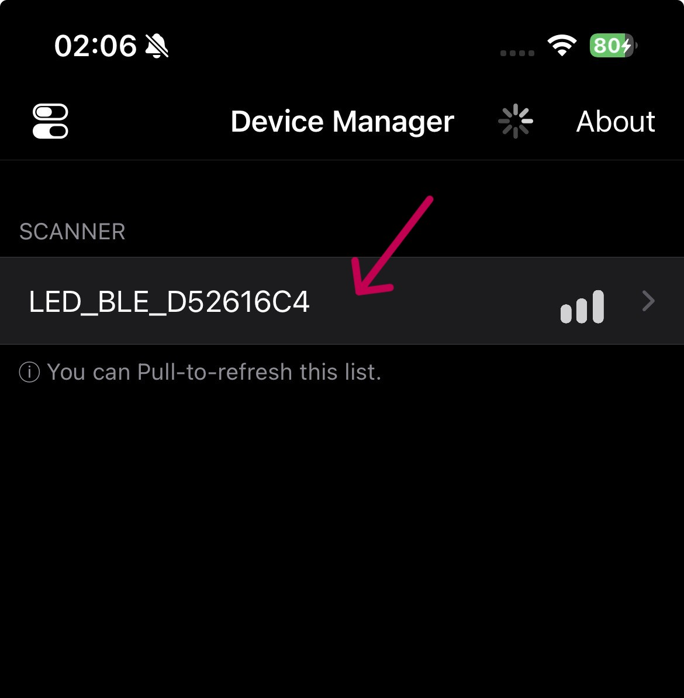
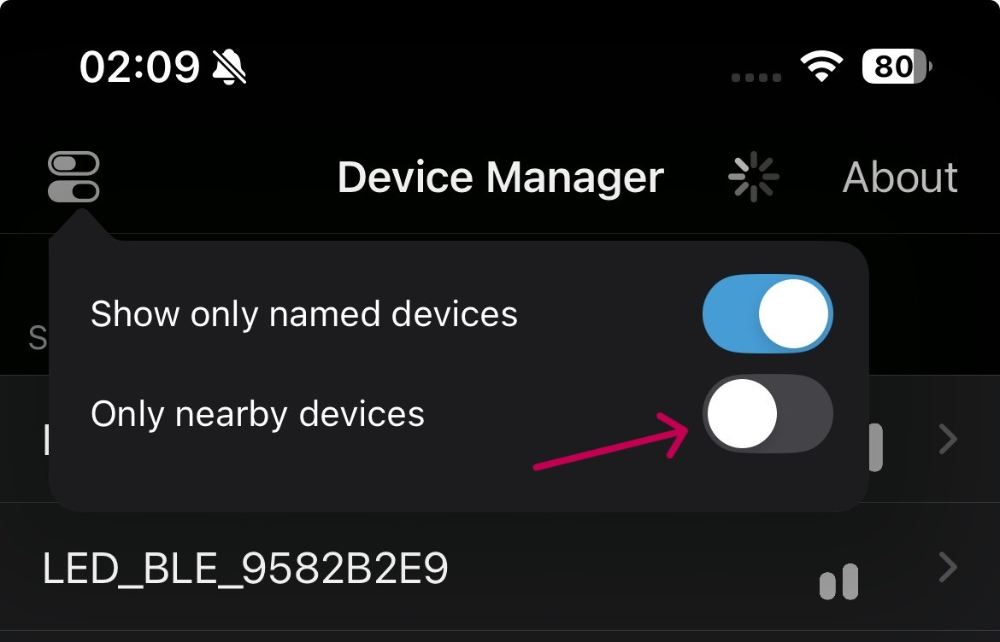
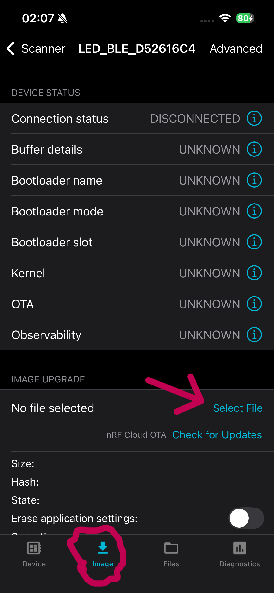
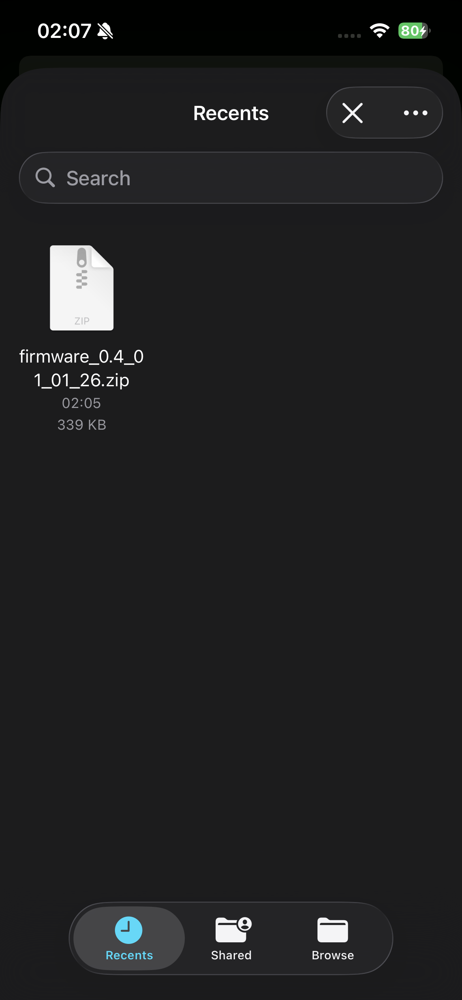
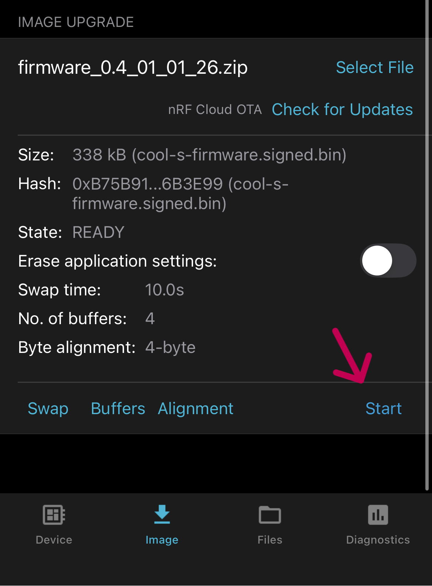
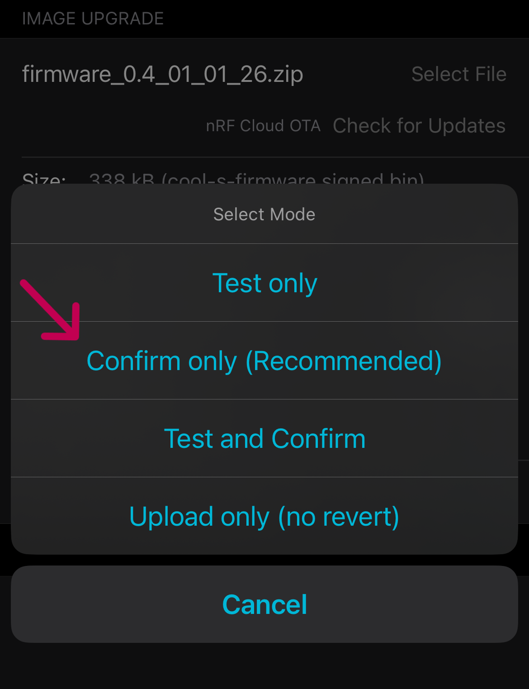
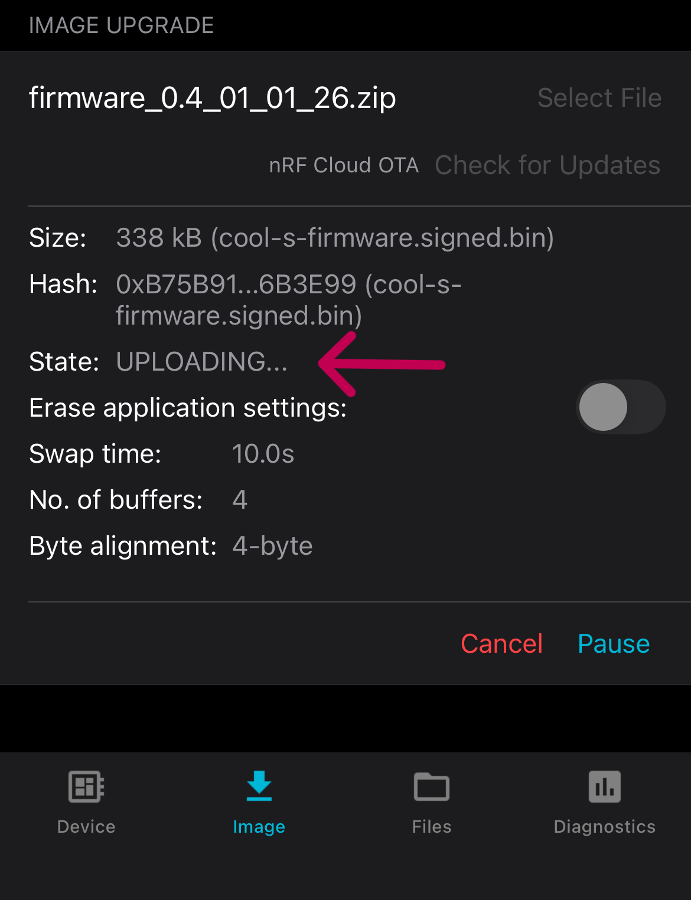
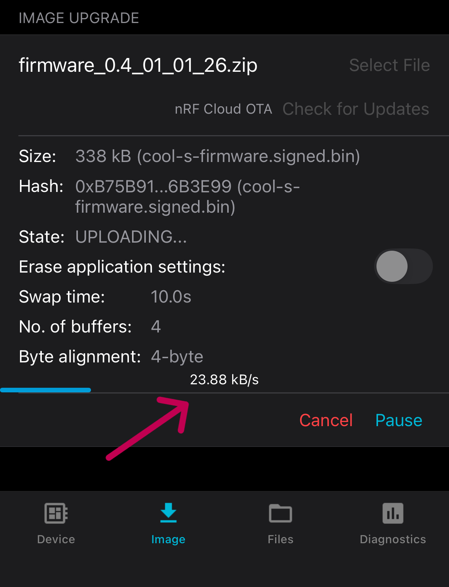
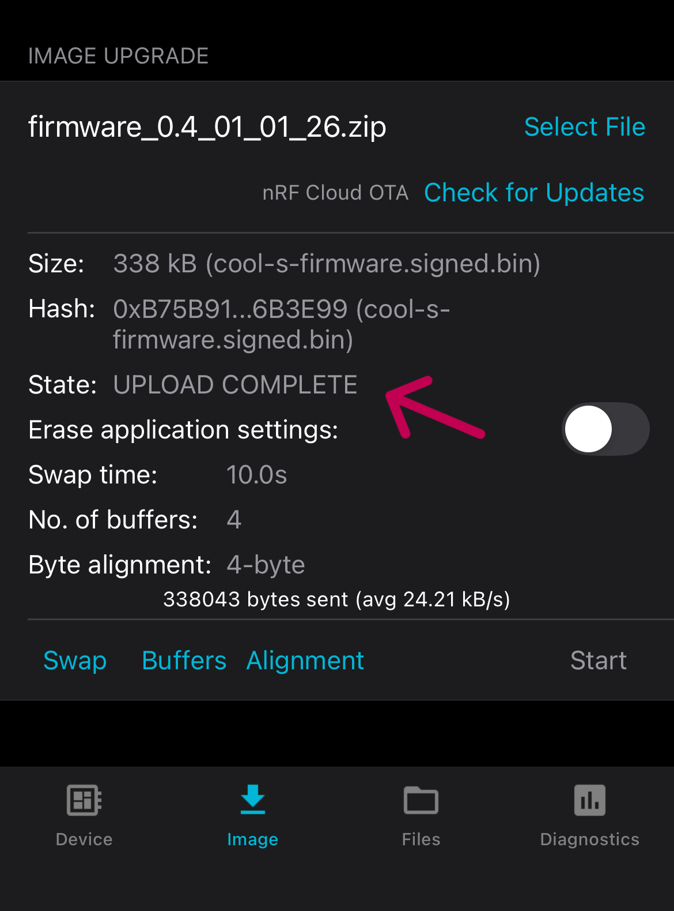

OTA Firmware Update Instructions
=============================
Use the WebUI for the easiest way to flash, if that gives trouble this is an alternative route.

- Install Nordic Device Manager app: https://www.nordicsemi.com/Products/Development-tools/nRF-Connect-Device-Manager

- Download the latest firmware .zip file from the root of this repository. (e.g. cool-s-firmware-v0.4.zip)

- Open the Nordic Device Manager app.

- Click on the "LED_BLE_XXXXXXXX" device in the list. (with XXXXXXXX being the last four bytes of the MAC address)

- If the device does not appear click on the filter icon and untick the "Only nearby devices" option. If its still not showing make sure the device has power.

- Go to the "Image" tab, scroll down and click on the "Select file" button to choose the downloaded .zip firmware file.

- Click on the "Start" button to start the firmware update.

- A popup will ask what type of update to run. Select "Test and Confirm", not the "Confirm only" option that the app recommends and the arrow in the picture points at. Only with "Test and Confirm" can the badge return to its previous firmware if the new one does not work.

- On firmware newer than v0.6 the badge now breathes yellow. Press each of its four buttons twice within 30 seconds to allow the update. If you are too late, or the app reports "access denied", press Start again. If the app says "Upload complete" immediately and then times out while the badge is yellow, press the buttons and then Start again.

- Wait for the update to complete. This may take up to a minute. It should show the "Uploading" message and then start a progress bar after a few seconds. If it immediately says "Upload complete" then you already have the latest firmware installed.

- After the upload is complete the device will reboot and should show up again in the device list after about 30 seconds. You can go back to the iPixel app and reconnect to it to verify the new firmware is working. No need to keep the Device Manager app open after the Update Complete message is shown.

